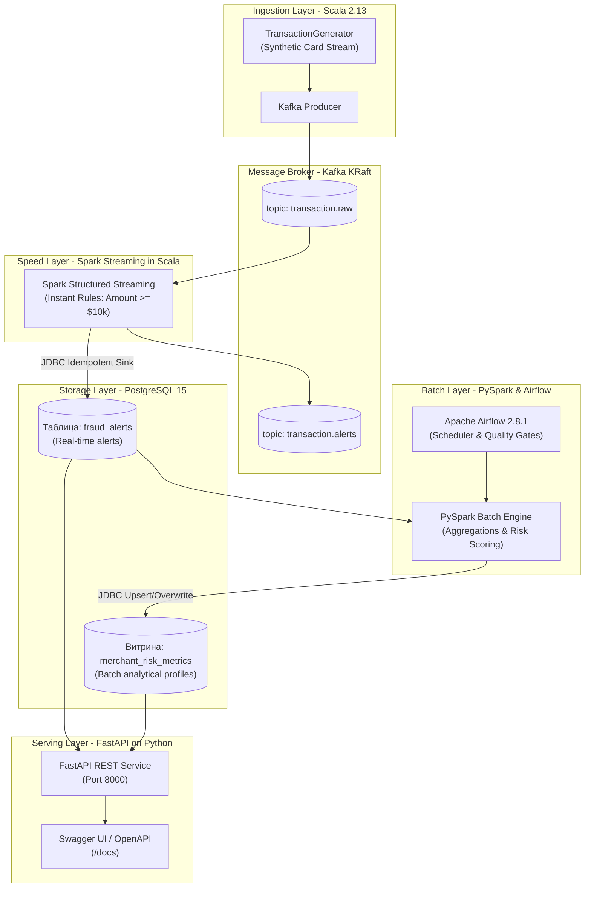

# Real-Time & Batch Financial Fraud Detection Platform


Полнофункциональная enterprise-платформа обнаружения финансовых аномалий и мошеннических транзакций в реальном времени и батч-режиме, построенная на принципах **Lambda-архитектуры**.

---

## Архитектура системы



---

## Ключевые слои и компоненты

1. **Ingestion Layer (`ingestion-scala/`)**:
   - Высокопроизводительный генератор синтетического потока банковских транзакций (95% легитимный трафик, 5% целевые аномалии и критический фрод) на **Scala 2.13**.
   - Асинхронная отправка событий в топик Kafka `transaction.raw`.

2. **Speed Layer (`streaming-spark/`)**:
   - Движок потоковой обработки на **Apache Spark 3.5.1 Structured Streaming** (Scala).
   - Мгновенная фильтрация и обогащение подозрительных операций (криптовалютные шлюзы, казино, подозрительные объемы).
   - Мультисинк: параллельная запись в Kafka (`transaction.alerts`), консоль и реляционное хранилище.

3. **Storage & Idempotency (`docker/`)**:
   - Кластер **PostgreSQL 15** и **Apache Kafka в режиме KRaft** (без зависимости от ZooKeeper).
   - Идемпотентная запись алертов через `foreachBatch` и JDBC PreparedStatement с конструкцией `ON CONFLICT (transaction_id) DO NOTHING` для предотвращения дубликатов при сбоях.

4. **Batch Analytics Layer (`batch-analytics/` + `batch-airflow/`)**:
   - Аналитический расчет сводных метрик и динамического скоринга риска (Risk Score от 0 до 100) на **PySpark**.
   - Оркестрация в **Apache Airflow 2.8.1**:
     - *Pre-check*: валидация наличия данных;
     - *PySpark Job*: распределенный расчет метрик риска;
     - *Data Quality Gate*: автоматический аудит целостности витрины (`merchant_risk_metrics`).

5. **Serving Layer (`serving-api/`)**:
   - Быстрый REST API на **FastAPI** с пулом потокобезопасных соединений `ThreadedConnectionPool`.
   - Валидация и строгая типизация ответов через **Pydantic v2** и управление конфигурацией через `pydantic-settings`.
   - Автоматическая интерактивная документация OpenAPI (Swagger UI).

---

## Структура репозитория

```text
fraud-detection-platform/
├── docker/                     # Инфраструктура (Docker Compose, Dockerfile для Airflow+PySpark)
├── ingestion-scala/            # Scala-генератор и продюсер транзакций
├── streaming-spark/            # Spark Structured Streaming движок
├── batch-analytics/            # Пакетные PySpark-скрипты расчета риск-профилей
├── batch-airflow/              # DAG'и и плагины Apache Airflow
├── serving-api/                # FastAPI сервис обслуживания аналитики
└── README.md
```

---

## Быстрый запуск (Quick Start)

### 1. Запуск инфраструктуры
```bash
cd docker
docker compose up -d --build
```
Сервисы:
- PostgreSQL: `localhost:5435`
- Kafka KRaft: `localhost:29092`
- Airflow Web UI: `http://localhost:8080` (логин: `airflow`, пароль: `airflow`)

### 2. Запуск генератора и потоковой обработки
```bash
# В терминале 1 (Стриминг):
cd streaming-spark
sbt run

# В терминале 2 (Генерация транзакций):
cd ingestion-scala
sbt run
```

### 3. Запуск батч-пайплайна
В интерфейсе Airflow (`http://localhost:8080`) включить и запустить DAG:
- `batch_risk_scoring_dag`

### 4. Запуск Serving API
```bash
cd serving-api
python -m venv .venv
# Активация:
# Windows cmd: .venv\Scripts\activate
# Linux/macOS: source .venv/bin/activate
pip install -e .
uvicorn app.main:app --reload --port 8000
```
Интерактивная документация доступна по адресу:
👉 `http://localhost:8000/docs`

---

## Эндпоинты API

| Метод | Путь | Описание |
| :--- | :--- | :--- |
| `GET` | `/health` | Проверка здоровья сервиса и соединения с PostgreSQL |
| `GET` | `/api/v1/alerts/recent` | Список свежих инцидентов фрода из стриминга |
| `GET` | `/api/v1/alerts/stats` | Сводная статистика по всем инцидентам (объем, средний чек) |
| `GET` | `/api/v1/analytics/merchant-risks` | Аналитическая витрина риск-профилей по категориям |
| `GET` | `/api/v1/analytics/merchant-risks/{category}` | Детальный скоринг конкретной категории мерчанта |